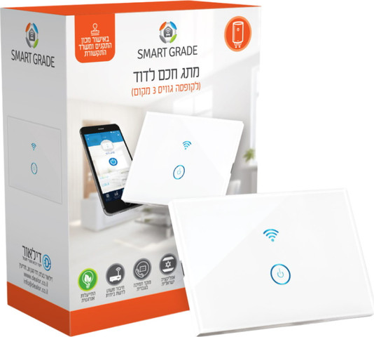

<div align="center">

# homebridge-smartgrade

**Control SmartGrade Secure (IoTech Verticals / Dealor · דילאור) Wi‑Fi smart switches from Apple Home via Homebridge.**

**English** | [עברית](README.md)

[](https://github.com/sobelman/homebridge-smartgrade/actions/workflows/ci.yaml) [](LICENSE) [](https://homebridge.io) [](https://github.com/sobelman/ha-smartgrade)



</div>

> [!WARNING]
> This is an **unofficial**, community-built plugin. It is not affiliated with, endorsed or supported by IoTech Verticals or Dealor. The vendor cloud API is undocumented and may change at any time.

## What it does

SmartGrade Secure is the app for the cloud‑connected smart switches made by **IoTech Verticals** and sold in Israel by **Dealor** – best known for the glass‑panel **boiler (water heater) switch**. The devices only talk to the vendor cloud, so this plugin uses the same cloud as the app.

- 🔐 **Log in from the Homebridge UI** – enter your phone number, press **Send SMS**, type the code. No config.json editing.
- 🎛️ **Choose the HomeKit accessory type per device (or per relay)** – **Switch**, **Outlet** or **Valve** (generic valve or water faucet icon). Valve is suggested for boilers, Outlet for sockets.
- 🔀 **Multi‑relay devices** – each relay (`switch_1`…`switch_3`) becomes its own accessory, named after the relay names set in the app.
- ⚡ **Optional power readings** – power (W), current (A) and voltage (V) as read‑only Eve characteristics.
- 📋 **Device details in the settings screen** – model (English + Hebrew), MAC, firmware and pending update, online state, relays, max‑on time, signal strength, the **timers configured in the app** and the **next scheduled action** (all read‑only).
- 📴 Offline devices and an expired login show as **No Response** in Home instead of a wrong state.

The sibling **Home Assistant** integration lives at [sobelman/ha-smartgrade](https://github.com/sobelman/ha-smartgrade).

## Installation

1. In the Homebridge UI open **Plugins**, search for **`homebridge-smartgrade`** and install it
   (or `npm install -g homebridge-smartgrade`).
2. Open the plugin's **Settings**. Running it as a **child bridge** is recommended.
3. Log in (below), press **Save**, and restart Homebridge.

Requirements: Homebridge 1.8+ or 2.x, Node.js 20, 22 or 24, and a SmartGrade / Dealor account with at least one device.

## Logging in (SMS code)

The vendor has no username/password – the app logs in with a one‑time SMS code. The plugin's custom settings screen does the same:

1. Enter the mobile number registered in the Dealor app (`05XXXXXXXX`; `+972…` is accepted too) and press **Send SMS**.
2. Enter the code from the SMS and press **Log in**.
3. The settings screen saves the resulting **login token (JWT)** and your user id into the plugin config. Restart Homebridge (or just the child bridge).

The status badge at the top of the settings screen always shows whether you are logged in and how many days the token has left.

> ### ⚠️ **Monthly re‑login required**
> **The vendor's login token is valid for exactly 30 days and the cloud has no refresh endpoint.** When it expires the devices show **No Response** and the Homebridge log says so. About once a month, open the plugin settings, press **Send SMS**, enter the new code, save and restart. The settings screen and the log start warning **5 days before** expiry. This is a limitation of the vendor cloud, not of the plugin; the official app asks for a new SMS code too.

## Accessory type per device

Every relay is exposed as a **Switch** unless you choose otherwise. In the settings screen press **Load devices** and then **Add as …** to add a device with its suggested type, or edit the **Per‑device settings** list:

| Setting | Meaning |
|---|---|
| `id` | Device id (12 hex digits, shown in the device list). |
| `relay` | Optional. 1–3 to configure a single relay; empty = all relays of the device. A relay entry wins over a device entry. |
| `name` | HomeKit name. |
| `accessoryType` | `switch` (default), `outlet` or `valve`. |
| `valveType` | For valves: `generic` (default) or `faucet` (water faucet icon). |
| `hidden` | Do not expose this device/relay. |

| Type | HomeKit service | Characteristics |
|---|---|---|
| Switch | `Switch` | `On` |
| Outlet | `Outlet` | `On`, `OutletInUse` (from the power reading when available, otherwise follows `On`) |
| Valve | `Valve` (`GENERIC_VALVE` or `WATER_FAUCET`) | `Active`, `InUse`, `ValveType` |

Changing the type keeps the same accessory (the old service is replaced), so the room assignment survives.

Example `config.json` (normally written by the settings screen):

```json
{
  "platform": "SmartGrade",
  "name": "SmartGrade",
  "pollInterval": 30,
  "exposePower": false,
  "devices": [
    { "id": "aabbccddeeff", "name": "Boiler", "accessoryType": "valve", "valveType": "generic" },
    { "id": "112233445566", "relay": 2, "accessoryType": "outlet" },
    { "id": "112233445566", "relay": 3, "hidden": true }
  ]
}
```

`jwt` and `userId` are added by the login screen. Do not share them.

### Other options

| Option | Default | Meaning |
|---|---|---|
| `pollInterval` | `30` | Seconds between state refreshes (min 15). After a command the state is re‑read after ~3 s. |
| `exposePower` | `false` | Adds read‑only Eve **Consumption (W)**, **Electric Current (A)** and **Voltage (V)** characteristics from the device's last reading (updated by the device about once a minute). Visible in Eve and similar apps, not in Apple Home. |

## Supported devices

| Products (product id) | Exposed as |
|---|---|
| Boiler switches (6, **8**) | Relay → Switch / Outlet / Valve (Valve suggested) |
| Sockets and plug adapters (2, 5, 16, 17) | Relay → Switch / Outlet / Valve (Outlet suggested) |
| Wi‑Fi switch (7), light switches 1–3 gangs (9–13), DIN rail switches (14, 15, 22) | One accessory per relay |
| Shutters (18, 19, 36) | Hidden by default; add them to the device list to expose their relays as plain switches (state mapping unverified) |
| AC panels, IR, gateway, power meter, sensors | Not exposed (no on/off relay) – still listed with details in the settings screen |

> **Only product 8 (Gewiss 3‑module boiler switch, single relay) has been tested on a live account.** Everything else follows the official app's models and is untested – reports and fixes are welcome.

## Timers

Timers created in the Dealor app are stored and run **in the vendor cloud**, so they keep working whether or not Homebridge is running. HomeKit has no way to represent them, so the plugin **does not change them**; the settings screen lists them (name, enabled, kind, days, on/off times or on/off minutes, date range) together with the next scheduled action.

## Not exposed

- **IP address and Wi‑Fi network (SSID)** – the vendor API does not return them.
- **Account details** (name, e‑mail, phone) – deliberately not shown.
- **Energy (kWh)** – the API's kWh history uses unverified units, so it is not exposed.
- **Live push (MQTT)** – the vendor broker ties the connection to the user id and would disconnect the phone app, so the plugin polls.

## Privacy and security

- The plugin talks only to `https://api.iotechv.com` (the vendor cloud), using the app‑level credentials that ship inside the official app plus your own login token.
- Your token is stored in Homebridge's `config.json`. Anyone with it can control your devices for up to 30 days – keep backups private.
- There is no automatic SMS forwarding or token renewal, by design.

## Development

```bash
npm install
npm run lint     # eslint + type-check (including tests)
npm test         # node:test with a mocked fetch – never touches the real cloud
npm run build    # tsc -> dist/, copies the settings UI
```

Layout: `src/api/` (cloud client, ported from the Home Assistant integration), `src/platform.ts` (discovery, polling), `src/platformAccessory.ts` (Switch / Outlet / Valve), `homebridge-ui/` (custom settings screen: `server.ts`, `handlers.ts`, `public/index.html`).

## Disclaimer

SmartGrade, IoTech Verticals and Dealor are trademarks of their respective owners. This project is provided as‑is under the [MIT license](LICENSE); use it at your own risk, especially with high‑power loads such as a water heater.
