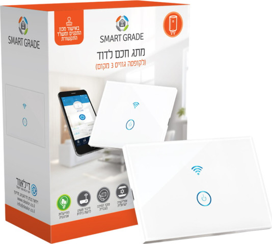

# homebridge-smartgrade

**שליטה במתגים החכמים של SmartGrade Secure (IoTech Verticals / דילאור) מתוך אפליקציית הבית של אפל, דרך Homebridge.**

[English](README.en.md) | **עברית**

> [!WARNING]
> זהו פלאגין **לא‑רשמי** שנבנה על ידי הקהילה. הוא אינו קשור ל‑IoTech Verticals או לדילאור, ואינו נתמך או מאושר על ידן.

## מה הפלאגין עושה

- 🔐 **התחברות מתוך ממשק Homebridge** – מזינים מספר טלפון, לוחצים **שלח SMS**, ומקלידים את הקוד. בלי לערוך את config.json.
- 🎛️ **בחירת סוג האביזר ב‑HomeKit לכל מכשיר (או לכל ממסר)** – **מתג (Switch)**, **שקע (Outlet)** או **ברז/מגוף (Valve)**. לדוד מומלץ Valve, לשקעים Outlet.
- 🔀 **מכשירים עם כמה ממסרים** – כל ממסר מופיע כאביזר נפרד, עם השם שהוגדר באפליקציה.
- ⚡ **קריאת חשמל (אופציונלי)** – הספק (W), זרם (A) ומתח (V) כמאפייני Eve לקריאה בלבד.
- 📋 **פרטי המכשיר במסך ההגדרות** – דגם (עברית ואנגלית), כתובת MAC, גרסת קושחה ועדכון ממתין, מחובר/מנותק, ממסרים, זמן הדלקה מקסימלי, עוצמת אות, **הטיימרים שהוגדרו באפליקציה** ו**הפעולה המתוזמנת הבאה** (הכל לקריאה בלבד).
- 📴 מכשיר מנותק או התחברות שפגה מוצגים כ"אין תגובה" באפליקציית הבית, ולא כמצב שגוי.

גרסת **Home Assistant**: [sobelman/ha-smartgrade](https://github.com/sobelman/ha-smartgrade).

## התקנה

1. בממשק Homebridge פותחים **Plugins**, מחפשים **`homebridge-smartgrade`** ומתקינים.
2. פותחים את **Settings** של הפלאגין (מומלץ להריץ כ‑child bridge).
3. מתחברים (ראו למטה), לוחצים **Save** ומפעילים מחדש את Homebridge.

## התחברות עם קוד SMS

1. מזינים את מספר הנייד הרשום באפליקציית דילאור (`05XXXXXXXX`) ולוחצים **שלח SMS**.
2. מזינים את הקוד שהתקבל ולוחצים **התחבר**.
3. מסך ההגדרות שומר את **טוקן ההתחברות (JWT)** ואת מזהה המשתמש בהגדרות הפלאגין. מפעילים מחדש את Homebridge.

> ### ⚠️ **נדרשת התחברות מחדש פעם בחודש**
> **הטוקן של היצרן תקף ל‑30 יום בדיוק, ואין בענן שלהם אפשרות לחדש אותו.** כשהוא פג, המכשירים מוצגים כ"אין תגובה" והלוג של Homebridge מודיע על כך. פעם בחודש בערך נכנסים להגדרות הפלאגין, לוחצים **שלח SMS**, מזינים את הקוד החדש, שומרים ומפעילים מחדש. מסך ההגדרות והלוג מתחילים להזהיר **5 ימים לפני** שהטוקן פג. זו מגבלה של הענן של היצרן – גם האפליקציה הרשמית מבקשת קוד SMS חדש.

## סוג אביזר לכל מכשיר

כברירת מחדל כל ממסר מופיע כ**מתג**. במסך ההגדרות לוחצים **טען מכשירים** ואז **Add as …** כדי להוסיף מכשיר עם הסוג המומלץ, או עורכים את רשימת **Per‑device settings**:

- `id` – מזהה המכשיר (12 תווים, מופיע ברשימת המכשירים).
- `relay` – אופציונלי: 1–3 לממסר בודד; ריק = כל הממסרים.
- `name` – השם ב‑HomeKit.
- `accessoryType` – ‏`switch` (ברירת מחדל), ‏`outlet` או `valve`.
- `valveType` – לברז: ‏`generic` (מגוף כללי) או `faucet` (ברז מים).
- `hidden` – הסתרה מ‑HomeKit.

## מכשירים נתמכים

- מתגי דוד (6, **8**), שקעים ומתאמים (2, 5, 16, 17), מתג WIFI ‏(7), מתגי תאורה 1–3 (9–13), מתגי פס דין (14, 15, 22) – אביזר לכל ממסר.
- תריסים (18, 19, 36) – מוסתרים כברירת מחדל; אפשר להוסיף אותם לרשימה (כמתגים פשוטים, לא נבדק).
- מזגנים, IR, גייטווי, מונה חשמל וחיישנים – לא מוצגים ב‑HomeKit (אין להם ממסר), אבל מופיעים עם פרטים במסך ההגדרות.

> **רק מוצר 8 (מתג חכם לדוד לגוויס 3 מקומות) נבדק בפועל על חשבון אמיתי.** כל השאר מבוססים על המודלים של האפליקציה הרשמית ולא נבדקו.

## טיימרים

הטיימרים שמגדירים באפליקציית דילאור נשמרים ורצים **בענן של היצרן**, ולכן ממשיכים לעבוד גם כש‑Homebridge כבוי. הפלאגין **לא משנה אותם** – רק מציג אותם במסך ההגדרות (שם, פעיל, סוג, ימים, שעות) יחד עם הפעולה המתוזמנת הבאה.

## מה לא נחשף

- **כתובת IP ושם הרשת האלחוטית (SSID)** – ה‑API של היצרן לא מחזיר אותם.
- **פרטי החשבון** (שם, אימייל, טלפון) – לא מוצגים בכוונה.
- **צריכת אנרגיה (kWh)** – היחידות לא מאומתות.

## הסתייגות

SmartGrade, ‏IoTech Verticals ודילאור הם סימנים מסחריים של בעליהם. הפרויקט מסופק כמות שהוא תחת [רישיון MIT](LICENSE); השימוש באחריותכם, במיוחד עם עומסים גבוהים כמו דוד חשמל.

